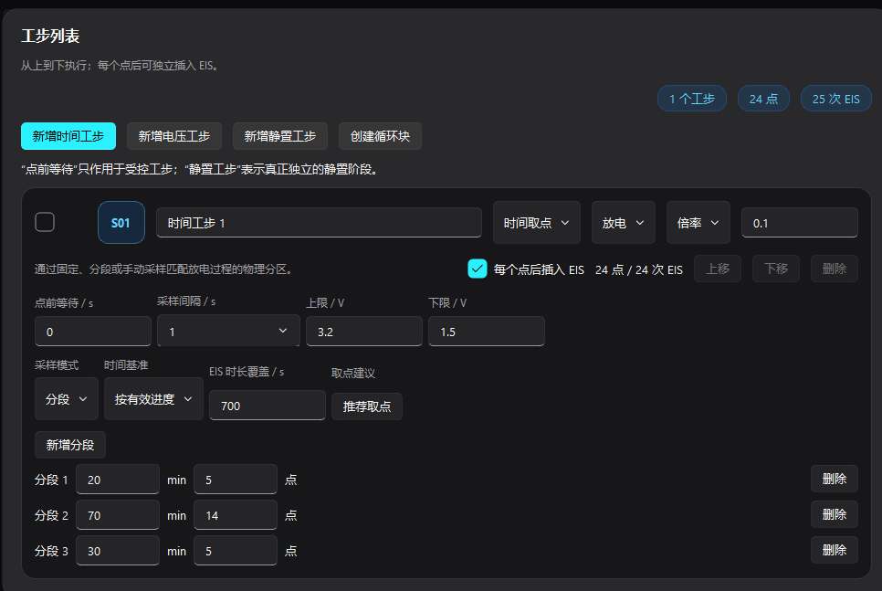
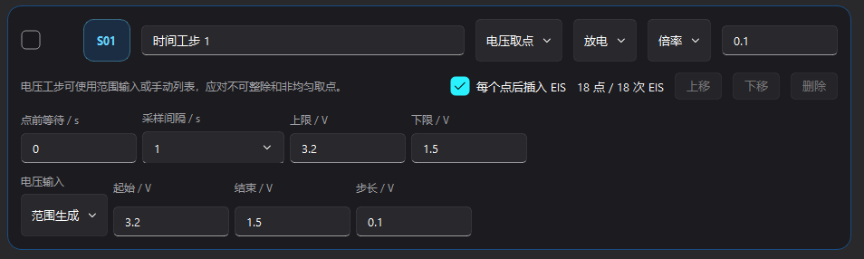
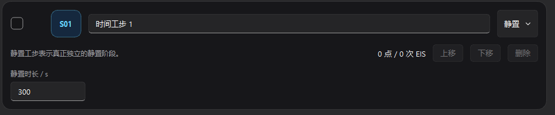
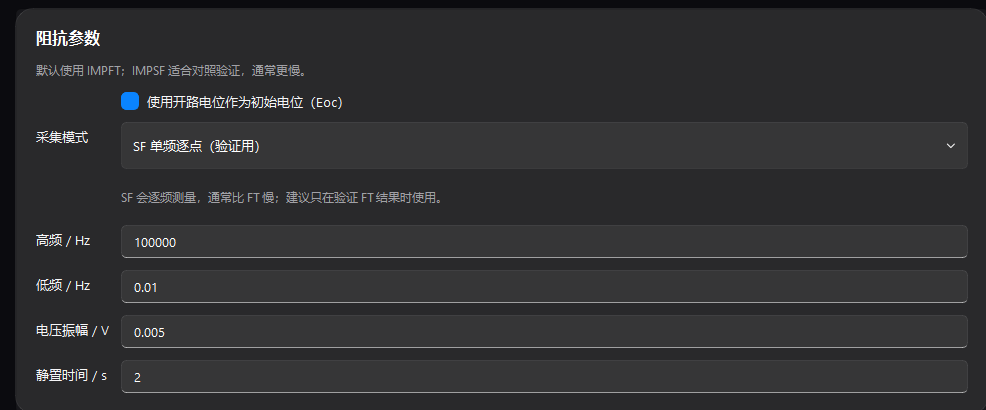

<div align="center">


<h2>把实验方案变成 CHI 脚本</h2>

<p>A local desktop tool for CHI in-situ EIS macro generation.</p>

<p>
  <a href="pyproject.toml"></a>
  <a href="pyproject.toml"></a>
  <a href="LICENSE"></a>
</p>

<p>
  <a href="#核心功能">核心功能</a> ·
  <a href="#快速开始">快速开始</a> ·
  <a href="#常见用法">常见用法</a> ·
  <a href="#参数与预览">参数与预览</a> ·
  <a href="#使用边界">使用边界</a> ·
  <a href="#文档导航">文档导航</a>
</p>

</div>

---

OPEIS Master 是给电池与材料研究人员使用的本地 CHI 原位阻抗（EIS）脚本生成器，把充放电工步和取点方案转为辰华工作站的宏命令，减少手写脚本的重复工作。

做原位 EIS 时，实验方案往往需要反复插入「恒流运行 → 阻抗测量 → 继续运行」，还要分别计算倍率电流、每段时长和保存文件名。OPEIS Master 将这些设置集中到一个界面：你组织实验工步，软件展开点位、检查参数，并生成脚本。

当前源码版本为 **0.3.0**，采用 PySide6 / Fluent Widgets 桌面界面。下文介绍的是当前源码已实现的功能。

## 核心功能

| 你想做什么 | 软件如何帮助你 |
| --- | --- |
| 在充放电过程中按计划测阻抗 | 按时间、目标电压或放电深度（DOD）取点，在点后插入 EIS |
| 组织多段实验 | 将充电、放电、静置工步依次组合，用循环块重复连续工步 |
| 比较脉冲扰动前后的状态 | 配置弛豫、脉冲及前后 EIS，可追加电压放电段 |
| 减少电流换算和命名错误 | 按材料容量或已知倍率电流换算 1C，也可直接输入电流；自动区分各段文件名 |
| 在复制前发现方案问题 | 实时查看取点、历时估算和风险提示；错误阻止生成，高风险警告需确认后才能复制 |
| 复用已有实验方案 | 保存和打开本地 `.chi-preset` 预设，快速返回最近使用的方案 |


输入参数后，软件换算电流、展开取点并校验方案，输出可粘贴到 **CHI Macro Command** 的极简脚本。计算公式和说明留在应用内，复制出的脚本只包含命令和数值。

### 两种工作模式

| 模式 | 实验如何组织 | 适合场景 |
| --- | --- | --- |
| 序列 | 时间、电压、DOD、静置工步按顺序执行，连续工步可组成循环块 | 沿充放电过程追踪阻抗、比较不同状态、重复多段流程 |
| 脉冲 | 初始 EIS 后，重复弛豫、脉冲前 EIS、脉冲及脉冲后 EIS | 比较瞬态扰动前后的阻抗变化，随后可追加电压放电段 |

### 从方案到脚本


计算、校验和脚本生成在本地完成。界面会随参数变化刷新摘要和预览，让你在复制前看到实际点位、EIS 次数及方案风险。

## 快速开始

### 安装并运行当前源码

以下为 **Windows PowerShell 下的主要安装路径**。需要 Python 3.11 和 Git；PySide6、Fluent Widgets 与 pydantic 由安装命令统一安装。

```powershell
git clone https://github.com/Jakiewbe/CHI-OPEIS.git
cd CHI-OPEIS
py -3.11 -m venv .venv
.\.venv\Scripts\python -m pip install -e .
.\.venv\Scripts\python -m chi_generator.main
```

已经下载源码时，在项目根目录从创建虚拟环境那一步开始即可。

### 完成第一个方案

1. 在「工作区」选择序列或脉冲模式，填写方案名称、文件前缀和导出目录。
2. 在「电池与电流」设置活性物质量、理论比容量，或填写已知倍率及对应电流。
3. 在「工步列表」添加时间、电压、DOD 或静置工步；脉冲模式则填写弛豫与脉冲参数。
4. 为各工步选择充电或放电，填写电流、电压窗口、采样间隔和取点方式。
5. 在「阻抗参数」设置测量方式、频率范围、振幅与静置时间。
6. 检查右侧总览、采样看板和脚本摘要，确认点位与预期一致。
7. 修正错误；若有高风险警告，点击确认按钮后再复制极简脚本。
8. 粘贴到 CHI Macro Command，核对保存位置，在 CHI 中运行实验。

### Windows 下载包

[GitHub 发布页](https://github.com/Jakiewbe/CHI-OPEIS/releases) 已提供 [v0.2.0 Windows x64 ZIP](https://github.com/Jakiewbe/CHI-OPEIS/releases/tag/v0.2.0)。**该下载包早于当前 0.3.0 源码，功能以对应版本为准。** 使用打包版时保留解压后的完整目录，运行 `CHI-OPEIS.exe`，不要单独移动 EXE 或删除 `_internal/`。

当前源码的 EXE 构建、分发及运行环境说明见 [打包说明](docs/packaging.md)；完整界面操作见 [使用说明](docs/usage.md)。

## 常见用法

以下点位用于说明设置方法；电流、电压窗口和等待时间需要按实际电池体系确定。

### 1. 按时间追踪阻抗

选择时间工步，让恒流过程推进到指定累计时间，再插入 EIS。适合已有基准充放电曲线、希望在关键进程点测阻抗的实验。

| 取点方式 | 如何设置 | 示例 |
| --- | --- | --- |
| 固定 | 总时长 + 固定间隔，或总时长 + 固定点数 | 60 min 内每 20 min 取点 |
| 分段 | 各段分别填写时长和点数 | 前期 20 min / 5 点，平台期 70 min / 14 点，末期 30 min / 5 点 |
| 手动 | 输入严格递增的累计时间列表 | `20, 40, 60 min` |

手动输入的 `20, 40, 60` 是累计时间；在「按有效进度」下，对应三段各 20 min 的恒流过程，EIS 和等待时间另计。



时间工步还支持三种时间基准：

| 时间基准 | 作用 |
| --- | --- |
| 按有效进度 | 只按恒流有效运行时间展开点位，中断增加实验总历时 |
| 按中断补偿 | 根据累计 EIS 中断时长调整后续恒流段 |
| 按等效容量补偿 | 按模型估算的 EIS 容量消耗缩短恒流保持时间 |

「推荐取点」可根据总时长与单次 EIS 时长给出固定取点建议。补偿和推荐都依赖估算，使用时应检查摘要中的点位、时长和偏移。

### 2. 按电压比较不同状态

选择电压工步，通过恒流 `CP` 到达目标电压。可按起始、结束和步长生成范围，也可输入非均匀的手动列表。

- 放电通常从高到低取点，例如 `3.2, 3.0, 2.8, 2.6 V`。
- 充电通常从低到高取点，例如 `2.6, 2.8, 3.0, 3.2 V`。
- 步长填正数，方向由「充电 / 放电」决定；安全电压窗口应覆盖计划点位。



到达电压点后，可以选择不同的测量状态：

| 方式 | EIS 如何开始 | 适合用途 |
| --- | --- | --- |
| 目标电压 PEIS | 使用 `ei=<目标电压>` | 比较指定电压下的阻抗 |
| 电压弛豫 EIS | 触发后静置，再用 `eio` 读取当前开路电位 | 比较电压触发后弛豫状态的阻抗 |
| 手动初始电位 | 使用工步指定的 `ei` | 实验方案明确指定测量电位 |

电压点是过程触发条件，不一定等于静置后的实际电位；目标电压测量与弛豫后测量应按实验目的区分。

### 3. 按 DOD 比较容量进度

DOD 表示放电深度。添加「DOD 准原位 EIS」，输入递增的百分比列表，例如 `20, 40, 60, 80%`，并选择容量基准：

| 容量基准 | 使用的数据 |
| --- | --- |
| 理论容量 | 活性物质量与理论比容量 |
| 用户参考容量 | 手动填写的参考容量（mAh） |
| 无 EIS 对照容量 | 无 EIS 对照实验得到的容量（mAh） |

软件将容量进度换算为恒流运行时间，随后按设置静置并用 `eio` 测量。DOD 是基于输入容量的计划值；如果先达到截止电压，实际过程可能无法完成所有点位。多个 DOD 工步的容量基准冲突时会阻止生成。

### 4. 组合静置、充放电与循环

需要完整循环时，可以按顺序组织：

```text
放电时间工步 → 静置工步 → 充电电压工步 → 静置工步
```

将连续工步组成循环块后，按设置次数重复执行。每个受控工步分别选择方向、电流和是否逐点插入 EIS，便于组合不同阶段。



「静置工步」是独立休息阶段，不充放电，也不产生 EIS 点；「点前等待」则作用于受控工步中的每个点，两者不能混为一谈。

### 5. 比较脉冲前后阻抗

选择脉冲模式，配置静置或恒流弛豫、脉冲电流、时长、次数、采样间隔和电压窗口。电流支持倍率或绝对值输入。

```text
初始 EIS
  ↓
弛豫 → 脉冲前 EIS → 恒流脉冲 → 脉冲后 EIS
  └──────────── 按脉冲次数重复 ────────────┘
  ↓
可选：追加电压放电段，并在各电压点后插入 EIS
```

弛豫可选静置或恒流；追加电压段在全部脉冲结束后执行一次。各轮保存名包含轮次，区分弛豫、脉冲和前后 EIS 数据。

## 参数与预览

### 电池、电流与文件保存

| 设置 | 需要填写或确认 |
| --- | --- |
| 按材料理论容量换算 1C | 活性物质量（mg）与理论比容量（mAh/g） |
| 按已知倍率电流换算 1C | 已知倍率（C）与对应电流（A） |
| 工步电流 | 选择倍率或直接输入安培；填写正值，软件按充放电方向处理符号 |
| 电压窗口 | 设置充放电的安全上、下限，并检查是否覆盖目标电压点 |
| 采样间隔 | 控制恒流段数据采样频率，与 EIS 取点间隔是不同设置 |
| 文件前缀与导出目录 | 决定 CHI 测量文件的名称与保存位置；目录留空时使用 `.` |

例如，`1 mg × 865 mAh/g = 0.865 mAh`，对应 `1C = 0.000865 A`；使用 `0.1C` 时，恒流为 `0.0000865 A`。这是换算示例，软件会依据你的实际输入重新计算。

### 阻抗参数



| 参数 | 含义 |
| --- | --- |
| 开路电位 / 手动初始电位 | 指定一般 EIS 段的初始电位；电压和 DOD 工步按各自策略处理 |
| FT / SF | 对应 `IMPFT` / `IMPSF`，界面默认选择 FT |
| 高频 `fh` / 低频 `fl` | 阻抗测量的频率范围，单位 Hz；高频必须高于低频 |
| 振幅 `amp` | 交流电压扰动幅度，单位 V |
| 静置时间 `qt` | 阻抗测量前的等待时间，单位 s |

工步自己的 EIS 初始电位策略优先于全局设置。低频端越低，单次测量通常越长；序列模式下 `fl=0.01 Hz` 会触发高风险提示，不能只根据取点数量判断总实验时长。

### 右侧看什么

| 区域 | 帮助检查的内容 |
| --- | --- |
| 总览与摘要 | 当前模式、1C 电流、取点数、EIS 次数、历时估算和工步安排 |
| 警告与错误 | 输入错误、长时间 EIS、频繁中断、方向切换和容量耗尽等风险 |
| 采样看板 | EIS 中断与 SoC 预测，辅助判断可能无法完成的点位 |
| 极简脚本 | 实际复制到 CHI 的命令，支持滚动查看 |

| 校验结果 | 是否可以复制 |
| --- | --- |
| 错误（Error） | 不生成可复制脚本，需先修正输入 |
| 普通警告（Warning） | 显示提示，允许复制 |
| 高风险警告 | 点击「我已确认高风险，允许复制」后才能复制；修改参数后需重新确认 |

### 预设与方案复用

「保存 / 另存为」将当前界面设置写入 `.chi-preset`；「打开」载入已有方案，「最近预设」便于继续之前的工作，「新建」恢复默认设置。预设保存的是参数，打开后仍需检查风险并重新复制生成的脚本。

## 输出脚本

脚本以 `fileoverride`、`folder` 和 `cellon` 开始，以 `celloff` 和 `end` 结束。时间恒流段使用 `tech=istep`，电压控制段使用 `tech=cp`，阻抗段使用 `tech=imp` 与 `impft` 或 `impsf`。每段测量后保存文件，名称自动区分工步、点位和类型。

下面是当前生成器实际输出的一个完整短方案：材料基准 `1 mg / 865 mAh/g`，`0.1C` 放电，累计 20 min 测一次 EIS，另含初始 EIS；低频设为 `1 Hz`。

```text
fileoverride
folder=.
cellon

tech=imp
eio
fh=100000
fl=1
amp=0.005
qt=2
impautosens
impft
run
save=CELL_A_EIS_OCV

tech=istep
is1=0.0000865
st1=1200
eh=3.2
el=1.5
si=1
cl=1
run
save=CELL_A_S01_CC_T20M

tech=imp
eio
fh=100000
fl=1
amp=0.005
qt=2
impautosens
impft
run
save=CELL_A_S01_EIS_T20M

celloff
end
```

摘要、公式和警告不会进入复制出的命令。上面的参数用于展示输出格式，实际实验应使用你自己的方案与安全窗口。

## 使用边界

- **软件负责生成脚本。** 设备连接和实验执行在 CHI 中完成；生成成功不等于已在你的仪器上验证。
- **历时与容量进度是估算。** EIS 会中断恒流过程，低频或密集取点会延长实验；电压控制段的真实耗时取决于电池响应，总历时和 SoC 预测可能显示为未知或不完整。
- **重复运行可能覆盖数据。** 脚本包含 `fileoverride`，会覆盖 CHI 中同名文件；每次实验应确认文件前缀和导出目录。

## 文档导航

| 文档 | 内容 |
| --- | --- |
| [使用说明](docs/usage.md) | 界面、参数、取点方式、预设与操作截图 |
| [打包说明](docs/packaging.md) | 开发安装、Windows EXE 构建与完整目录分发 |
| [架构说明](docs/architecture.md) | 界面与计算分层、主实现和兼容入口 |
| [领域说明](docs/domain.md) | 电流换算、取点规划和脚本语义 |
| [测试说明](docs/testing.md) | 测试运行方式与覆盖范围 |

### 项目结构

```text
src/chi_generator/
├── domain/       参数模型、电流换算、取点规划、校验与脚本生成
├── services/     预设文件服务
├── ui/           桌面界面、工步编辑与预览
├── app.py        应用装配
└── main.py       启动入口
src/opeis_master/ 兼容启动入口
tests/           领域、界面、入口及打包相关测试
docs/            使用、设计、测试与打包文档
image/           操作截图
```

界面负责收集参数与展示结果，领域层负责计算、校验和生成命令。开发安装与测试命令分别见 [打包说明](docs/packaging.md#开发安装) 和 [测试说明](docs/testing.md#运行方式)。

## 许可证

本项目采用 [MIT License](LICENSE)。Copyright © 2026 Jakiec。
