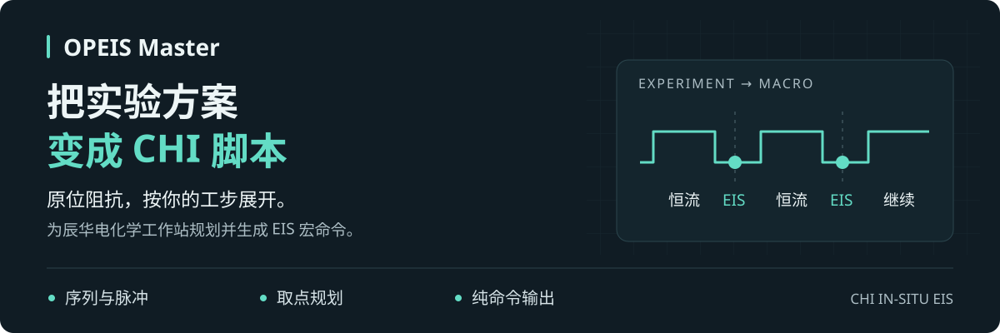
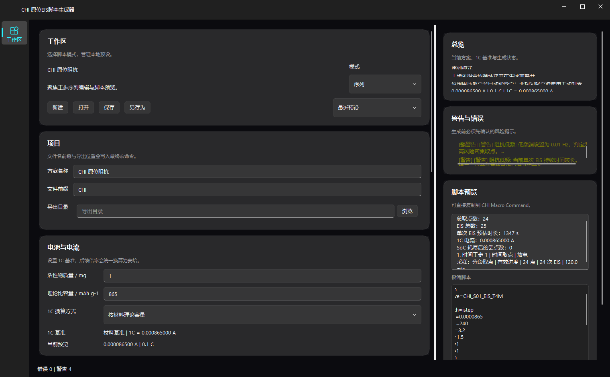

<div align="center">



<h2>把实验方案变成 CHI 脚本</h2>

<p>A local desktop tool for CHI in-situ EIS macro generation.</p>

<p>
  <a href="pyproject.toml"></a>
  <a href="pyproject.toml"></a>
  <a href="LICENSE"></a>
</p>

<p>
  <a href="#核心功能">核心功能</a> ·
  <a href="#快速开始">快速开始</a> ·
  <a href="#常见用法">常见用法</a> ·
  <a href="#使用边界">使用边界</a> ·
  <a href="#文档导航">文档导航</a>
</p>

</div>

---

OPEIS Master 是给电池与材料研究人员使用的本地 CHI 原位阻抗（EIS）脚本生成器，把充放电工步和取点方案转为辰华工作站的宏命令，减少手写脚本的重复工作。

## 核心功能

| 你想做什么 | 软件如何帮助你 |
| --- | --- |
| 在充放电过程中按计划测阻抗 | 按时间、目标电压或放电深度（DOD）取点，在点后插入 EIS |
| 组织多段实验 | 将充电、放电、静置工步依次组合，用循环块重复连续工步 |
| 比较脉冲扰动前后的状态 | 配置弛豫、脉冲及前后 EIS，可追加电压放电段 |
| 减少电流换算和命名错误 | 按材料容量或已知倍率电流换算 1C，也可直接输入电流；自动区分各段文件名 |
| 在复制前发现方案问题 | 实时查看取点、历时估算和风险提示；错误阻止生成，高风险警告需确认后才能复制 |
| 复用已有实验方案 | 保存和打开本地 `.chi-preset` 预设，快速返回最近使用的方案 |



输入参数后，软件换算电流、展开取点并校验方案，输出可粘贴到 **CHI Macro Command** 的极简脚本。计算公式和说明留在应用内，复制出的脚本只包含命令和数值。

## 快速开始

以下为 **Windows PowerShell 下的源码安装路径**。先安装 Python 3.11 和 Git，再执行：

```powershell
git clone https://github.com/Jakiewbe/CHI-OPEIS.git
cd CHI-OPEIS
py -3.11 -m venv .venv
.\.venv\Scripts\python -m pip install -e .
.\.venv\Scripts\python -m chi_generator.main
```

已经下载源码时，在项目根目录从创建虚拟环境那一步开始即可。依赖由安装命令统一安装，无需额外安装测试或打包工具。

打开界面后：

1. 在「工作区」选择序列或脉冲模式，填写方案名称、文件前缀和导出目录。
2. 设置 1C 基准、工步电流、电压窗口、取点方式及阻抗参数。
3. 检查右侧摘要、警告与错误，修正错误并确认高风险设置。
4. 点击「复制极简脚本」，粘贴到 CHI Macro Command，再由你在 CHI 中运行。

完整操作及截图见 [使用说明](docs/usage.md)；Windows EXE 的构建与分发方式见 [打包说明](docs/packaging.md)。

## 常见用法

| 实验目的 | 选择方式 |
| --- | --- |
| 按实验进程追踪阻抗 | 时间工步：固定间隔、固定点数、分段或手动时间列表 |
| 比较指定电压下的阻抗 | 目标电压 PEIS：到达目标电压后，以该电压作为 EIS 初始电位 |
| 观察电压触发后的弛豫状态 | 电压弛豫 EIS：到达电压点后静置，以当前开路电位测量 |
| 按放电容量进度比较阻抗 | DOD 准原位 EIS：按选定容量基准计算时间，静置后测量 |
| 重复放电、静置、充电过程 | 序列模式：组合工步，并将连续工步设为循环块 |
| 观察脉冲前后变化 | 脉冲模式：设置弛豫方式、电流、时长和重复次数 |

取点方式决定实验控制过程；阻抗测量可选择 `IMPFT` 或 `IMPSF`。各方式的设置和区别见 [工步与取点](docs/usage.md#工步与取点)。

## 使用边界

- **软件负责生成脚本。** 设备连接和实验执行在 CHI 中完成；生成成功不等于已在你的仪器上验证。
- **历时与容量进度是估算。** EIS 会中断恒流过程，低频或密集取点会延长实验；电压控制段的真实耗时取决于电池响应，总历时和 SoC 预测可能显示为未知或不完整。
- **重复运行可能覆盖数据。** 脚本包含 `fileoverride`，会覆盖 CHI 中同名文件；每次实验应确认文件前缀和导出目录。

## 文档导航

| 文档 | 内容 |
| --- | --- |
| [使用说明](docs/usage.md) | 界面、参数、取点方式、预设与操作截图 |
| [打包说明](docs/packaging.md) | 开发安装、Windows EXE 构建与完整目录分发 |
| [架构说明](docs/architecture.md) | 界面与计算分层、主实现和兼容入口 |
| [领域说明](docs/domain.md) | 电流换算、取点规划和脚本语义 |
| [测试说明](docs/testing.md) | 测试运行方式与覆盖范围 |

## 许可证

本项目采用 [MIT License](LICENSE)，版权归属见许可证文件。
